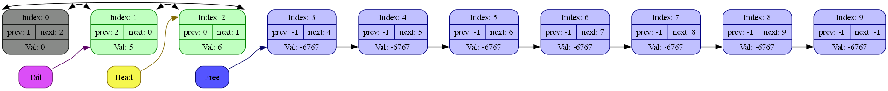
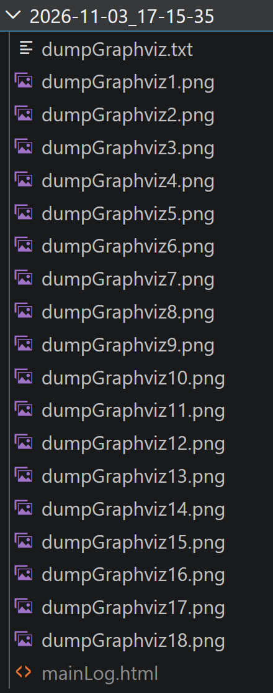

Этот проект является четвёртым заданием курса по программированию преподаваемого Ильёй Рудольфовичем Дединским(@ded32_ru) на первом курсе МФТИ ФРКТ.
Задание представляет из себя реализацию кольцевых кэш-френдли [двусвязных списков](https://en.wikipedia.org/wiki/Doubly_linked_list) с фиктивным элементом 

# Концепция реализации
Основным отличием данной реализации от общепринятой (например из языка C++) является хранение всех элементов списка в одном массиве и осуществление доступа к элементам по индексам массива.  
Иными словами каждый элемент ссылается не на сам узел, а на его индекс.
Плюсы такого подхода:
- удобно для кэширования (данные лежат в одном месте)
- быстро (нет постоянных реалокаций)
- легко вывести(передать) весь список целиком
Недостатки:
- реалокация при заполнения всего массива (ощутимые задержки в произвольный момент времени)
- риск использования ненужной памяти (выделили массив на 1000 элементов а используем 10)
- возможность легко "залезть" в данные самостоятельно и испортить их

Так же программа имеет достаточно богатый набор инструментов для отладки и обработки ошибок (подробнее в отделе Отладка)

# Доступные функции и возможности

Тип элементов в списке определяется `typedef ... listNodeVal;`

При создании списка все его элементы являются пустыми и входят в односвязный вспомогательный список free
Нулевой элемент играет роль фиктивного. Он не является ни пустым ни заполненным но позволяет исключить частный случай пустого списка (смотрите подраздел Кольцевой список и фиктивный элемент)

Здесь и далее под получением элемента подразумевается получение его индекса в массиве

Доступ и работа со списком происходит через следующие функции:
| функция| использование |
|-----|----|
|ListCtor               | Конструктор списка. Выделяет память, задаёт структуру списка пустых элементов и сохраняет отладочную информацию |
|InitFreeValuesList     | Формирует список пустых элементов находящихся в массиве. Не предназначена для вызова пользователями |   
|ListDtor               | Деконструктор списка. Освобождает память, обнуляет значения |
|ListGetHead            | Функция получения головы |
|ListGetTail            | Функция получения хвоста |
|ListGetNextElem        | Функция получения следующего элемента для данного |     
|ListGetPrevElem        | Функция получения предыдущего элемента для данного |
|ListGetElementByNumber | получение элемента по номеру в списке |        
|ListGetElementByValue  | получение первого элемента с заданным значением |   
|ListDump               | дамп списка. Используется при отладке |
|GenerateGraphvizFile   | Создание графического дампа списка. Для отладки |         
|ListVerify             | Верификатор. Запускается при отладке в каждой функции |
|ListResizeUp           | Внутренняя функция увеличения размеров массива в 2 раза. Автоматически добавляет новые элементы в список пустых элементов |
|ListAddNewNode         | добавляет новый узел после заданного |   
|ListDeleteNode         | удаляет заданный узел |

## Список пустых элементов
все элементы массива, не занятые списком, формируются в свой односвязный список. Это позволяет делать вставку и удаление как O(1)  
Любой элемент удалённый из списка становится новой головой списка пустых элементов(free).  
>[!NOTE]
>Признаком того, что элемент является пустым служит значение -1 в поле prev. По данному признаку элементы распознаются дампом и верификатором, поэтому не стоит менять это значение в ручную, иначе возможно неопределённое поведение

## Фиктивный элемент и закольцованность 
Список фактически является замкнутым на нулевой(фиктивный) элемент. Это позволяет программе считать, что список никогда не пуст

Для пользователя различий нет: этот элемент не хранит значения

Но функции и логика взаимодействия становятся гораздо проще:
``` C
//insert
if (список пустой)
if (создаю новую голову)
if (создаю новый хвост)

//delete
if (список опустел)
if (удалили голову)
if (удалили хвост)

// --- переходим к 

// NOTHING

```

# Отладка и обработка ошибок
Все функции возвращают результат своей работы в виде значения enum WORK_RES. 

В отладочном режиме каждая функция в начале и в конце своей работы выводит информацию о том, что она вызвана и как проходит её работа.  

Так же везде, где это возможно, вызывается верификатор и следом за ним дамп
>[!WARNING]
>В случае если сработал верификатор дамп не будет вызываться, так как высок риск неопределённого поведения.
>При необходимости вы можете вызвать дамп самостоятельно

Верификатор проверяет список на:
- наличие зацикленности
- соответствие данного и предыдущего для последующего 
- валидность списка пустых элементов(связность, что нет элементов не вошедших ни туда ни туда)

# Компиляция

Если вы хотите запустить программу в отладочном режиме то добавляйте к компилятору флаг `-DDEBUGGER`

Пример запуска с учётом режима отладки:
``` bash
g++ ./src/doubleLinkedList.cpp ./basic.cpp ./main.cpp YOUR_FLAGS -DDEBUGGER -o run.exe
./run.exe
```
## формат логов
Логи представляют собой html файл снабжённый подключёнными к нему картинками из графического дампа. вся такая информация хранится в папке, созданной для каждого вызова. Папка имеет название "дата_время" для уникальности. Например:
